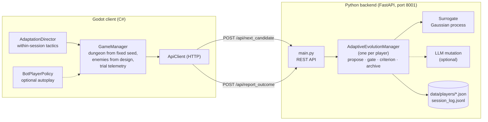

# Adaptive Dungeon Crawler

**Adaptive learning of enemy encounters in a procedural dungeon crawler.**
A 3D top-down dungeon crawler (Godot 4, C#) whose enemies adapt to each
player on two timescales:

- **Across trials**, a player-in-the-loop evolutionary search evolves the
  enemy encounter — how many enemies and in what packs, how strong and how
  fast, how many elites, and which of seven archetypes — on a fixed dungeon. A design is kept if and only if the player clears it (a
  *minimal criterion*), and an uncertainty-gated Gaussian-process surrogate
  decides the designs it is confident about, so the player's time is spent
  where the model is unsure.
- **Within a session**, a rule-based director watches the player's habits
  (rear attacks, breaking line of sight) and gives enemies matching tactics:
  newly spawned ones and, with live re-tasking, those already near the
  player.

23CSE498 Project Phase 2 · Team 5 · Amrita School of Computing, Coimbatore ·
Guide: Ms. Anisha Radhakrishnan

## Phase 2 review: what changed

| Panel comment | What we did |
|---|---|
| "Coevolution" is not the right term; use adaptive learning and be careful with terms | Only the encounter designs evolve; the player is not a co-evolving population. The project is now described as adaptive learning of enemy encounters, the method as minimal criterion search. "Coevolution" and "MCC" are gone from code, UI and docs (`Backend/adaptive_evolution.py`, game title, [design doc](docs/EVOLUTIONARY_DESIGN.md#terminology-phase-2-panel-review)). |
| Evolving both enemies and map defeats the purpose of evolution, since the environment keeps changing | Only the enemies evolve. Map size, room count, resource densities and the **layout itself** (seed 123) are fixed, so every trial is played on the same dungeon and a change in outcome is due to the enemies. The seed was chosen with [`tools/scan_map_seeds.py`](tools/scan_map_seeds.py); the integration test checks the dungeon is identical on every trial ([details](docs/INTEGRATION_TESTING.md)). |

The simulation study in our research paper also found two flaws in the first
version, now fixed: the surrogate gate used total uncertainty and stopped
working once outcome noise grew (it now uses epistemic uncertainty), and a
new player was served the same default design until it was cleared, which a
weak player almost never does (new players now get random designs until the
first pass). Each player also has their own archive and surrogate, so the bot
never trains a human player's model.

## Final version: what is new

- **Seven enemy archetypes.** The four originals (Brute, Skirmisher, Archer,
  Sentinel) now wind up before attacking, and three new ones **telegraph**
  their attacks so a skilled player can counter them: the **Charger** marks a
  line on the floor and dashes along it (then is stunned), the **Bomber**
  marks a 3×3 area and lobs a bomb at it, and the **Shieldbearer** blocks
  frontal hits and must be flanked. **Elite** variants are tougher and
  enrage at half health; **tempo** and **pack size** are evolved too — a
  twelve-gene encounter space ([ENEMY_AI.md](docs/ENEMY_AI.md)).
- **New look.** Every archetype has its own model built from engine
  primitives, with spawn, idle, step, wind-up, attack, hit, stun and death
  animations, health bars, floating damage numbers and floor telegraphs.
  `Scenes/EnemyGallery.tscn` shows them all.
- **A measured simulated player.** The game's duel mode measures how much
  damage each enemy deals (13,440 scripted duels, `tools/run_duels.py`); the
  simulator is built from those measurements and checked against the full
  dungeon (`tools/validate_simulator.py`).
- **Selection that sees composition.** An optional per-archetype criterion
  learns, from each player's own telemetry, which enemy types they handle
  badly and keeps those types from dominating their encounters. It filters
  what is proposed and served instead of failing cleared trials, so together
  with feasibility-biased probing it *lowers* how often the player fails.
- **Live re-tasking and interception.** The tactical director now updates
  enemies already on the map when it switches a countermeasure on or off,
  not only new spawns, and its stealth countermeasure sends enemies to
  intercept a hiding player on the route to the exit; both are evaluated in
  the game (`tools/evaluate_director.py`).
- **A better-calibrated surrogate and players who never fail.** GP
  classification is available as an alternative surrogate
  (`SURROGATE_MODEL=classifier`), and a stretch fallback serves harder
  versions of cleared designs to a player who has not failed yet, so the
  surrogate can train.
- **Stronger evaluation.** The search is compared with a DDA staircase,
  MAP-Elites and Bayesian-optimization difficulty targeting, in both the
  old six-gene and the new twelve-gene space, with two remedies for the
  player's experience (feasibility-biased probing, a lower bound on challenge).
- **Human-study tooling.** `--study` runs a complete session — consent,
  briefing, play, replay block, questionnaire — for two studies (the
  surrogate; the tactical director) against counterbalanced conditions, with
  export and analysis scripts and a protocol
  ([HUMAN_STUDY_PROTOCOL.md](docs/HUMAN_STUDY_PROTOCOL.md)). Both studies
  have been run end to end with twelve scripted participants
  (`tools/run_bot_study.py`).

## Architecture



One trial: the client asks for the next design → the backend proposes one
(mutating an archived design), auto-deciding any the surrogate is confident
about → the player plays it on the fixed dungeon → the client reports the
telemetry → the backend applies the minimal criterion, archives a pass, and
refits the surrogate on the outcome.

| Layer | Technology |
|---|---|
| Game client | Godot 4.7 (.NET), C# / .NET 8 |
| Backend | Python 3, FastAPI, Uvicorn, Pydantic |
| Surrogate | scikit-learn Gaussian process regressor |
| Analysis | NumPy, SciPy, Matplotlib, statsmodels |
| Optional LLM mutation | Anthropic / OpenAI API or a local Ollama model |
| Tests | xUnit (C#), pytest (Python), end-to-end script |

## Installation and running

**Prerequisites:** Godot 4.7 .NET edition, .NET SDK 8, Python 3.10+.

0. **Get the code**
   ```bash
   git clone https://github.com/s4nj1th/fin-yr-godot-version.git
   cd fin-yr-godot-version
   ```
1. **Backend**
   ```bash
   cd Backend
   python3 -m venv .venv
   source .venv/bin/activate        # Windows: .venv\Scripts\activate
   pip install -r requirements.txt
   uvicorn main:app --host 0.0.0.0 --port 8001
   ```
2. **Game** — open `project.godot` in Godot, build (or `dotnet build
   DungeonCrawler.csproj`), press **F5**. The game starts in `Main.tscn`.
   Controls: **WASD** move, **Space** attack, **R** quit the trial, **Esc**
   pause. Reach the exit; you may die at most three times.

The backend is optional — without it the game plays the default encounter on
the same map, without evolution.

**Options** (command line, after `--`):

```bash
godot-mono --path . -- --player=alice                  # play as player "alice"
godot-mono --path . -- --autoplay --autoplay-max-trials=20 --autoplay-timescale=8   # bot, as player "bot"
godot-mono --path . -- --study                         # one human-study session (needs the backend)
godot-mono --path . -- --autoplay --bot-style=hide --director=spawn --stealth=search   # bot that hides; director off|spawn|live; countermeasure intercept (default)|search
godot-mono --path . res://Scenes/EnemyGallery.tscn     # see every enemy type
python tools/run_duels.py                              # re-measure the enemies (writes Backend/duel_table.json)
Backend/.venv/bin/python tools/evaluate_director.py --sessions 30 --trials 15   # the director in the game
Backend/.venv/bin/python tools/run_bot_study.py --minutes 30                   # both studies, 12 scripted participants
```

**Without the game** (simulated player, from `Backend/`):

```bash
python auto_simulate_playthroughs.py --skill intermediate --trials 100
python generate_metrics_plots.py --player sim-intermediate     # charts in data/plots/
```

## Tests

```bash
cd Backend && pip install -r requirements-dev.txt && pytest     # 154 tests
cd Tests && dotnet test                                         # 82 tests
python tools/integration_test.py --trials 10                    # real game + real backend
python tools/integration_test.py --study                        # a complete automated study session
```

## Results

All quantitative results come from a simulated player whose damage model is
measured in the game; no human-subject data have been collected yet. Full
details, figures and statistics are in the project's research paper (kept
with the Phase 2 review materials).

Headline findings (50 runs per condition, intermediate player unless stated):

| Finding | Result |
|---|---|
| The simulator matches the game | held-out duels R² = 0.98; predicted threat vs. real-dungeon damage ρ = 0.79; a hand-derived damage model of the earlier kind deviates from the measurements by up to 3.8× |
| The total-uncertainty gate is unreliable | median 79 surrogate decisions per 100 playthroughs, fewer than ten in 8 of 49 runs; its noise floor reaches the gate threshold |
| The epistemic gate fixes it | 711 archived designs instead of 88 for the same 100 playthroughs (8.1×), 94% accuracy on the designs it decides itself; contamination 8.0% vs 5.5% |
| …at a cost to the player | the player fails 31% of played designs, against 12% without a surrogate; skipping uncertain designs predicted to fail lowered it from 29% to 24% in a separate 50-run study and *enlarged* the archive |
| Against the baselines | DDA, Bayesian-optimization targeting and an objective GA serve harder encounters but keep 62–77 designs, 11–18% of which the player would fail on replay |
| Six vs. twelve genes | the gate's gain holds (9.4× and 8.3×) |
| Cold start | in the six-gene space the original default design leaves 28 of 50 novice runs with nothing accepted; random designs until the first pass leave none |
| Adaptation is personal — in difficulty | an expert's designs are failed 59% of the time by a novice, against 10% for the novice's own |
| …and, with the per-archetype criterion, in composition | pass/fail alone leaves the enemy mix unchanged; pooling each player's damage per enemy type finds 89–98% of the types they handle badly and at least halves their share of the archive |
| …without failing more trials | applied as a filter instead of a verdict on cleared trials and combined with probing, it lowers the share of played designs the player fails below the gate alone (29% → 12% for a player who counters telegraphs, 30% → 21% for one who does not) |
| The tactical director in the game | against a bot that hides, enemies that *intercept* it on the route to the exit cut the share of trials that reach the exit from 92% to 83–85% and slow its crossings (Holm-corrected p ≤ 0.017); searching where it was last seen had no effect that survived correction (30 paired sessions per condition) |
| Both human studies, with scripted participants | a first dry run found that a player who never fails gets no benefit from the gate and that four replays per session are too few; with the stretch fallback and twelve replays, the gate cut playthroughs per archived design from 1.07 to 0.16 (p = 0.002) and the surrogate trained for every participant. A simulation-based power analysis sets the human study at 48 participants. Not human data |
| GP classification | a better-calibrated surrogate: less contaminated archives at every gate threshold; at threshold 0.35 the same archive size and failure rate as the regressor's default |
| Players who never fail | without a failure the surrogate cannot train; a stretch fallback (harder versions of cleared designs) let it train within a session in every run for a player who clears 97% of designs, tripling the archive |
| Other layouts | the simulator orders the bot's damage on four other maps as well as on the evaluation map (ρ = 0.81–0.84) |
| An archive never forgets | after a drop to novice skill, contamination jumps from 7% to 32%; a windowed surrogate lowers the played failure rate from 63% to 39% |
| LLM-guided mutation | no detectable benefit over Gaussian mutation (83% vs 86% offspring pass rate, 10-seed pilot) |

## Repository

| Path | Contents |
|---|---|
| `Main.tscn`, `Scripts/` | game client: `Core/` (game loop, rendering), `AI/` (enemy AI, director, bot), `Entities/`, `Network/`, `UI/`, `Data/` |
| `Scenes/` | enemy-AI sandbox scenes and the enemy gallery |
| `study/` | participant information sheet (template) for the human study |
| `Tests/` | C# unit tests |
| `Backend/` | evolution backend, simulated player, analysis scripts, tests |
| `tools/` | integration tests, duel measurements, simulator validation, study export and analysis, map-seed scan, screenshots |
| `docs/` | design documents |

## Documentation

**Project website and documentation portal:**
<https://adaptive-enemy-encounters.vercel.app> (installation, architecture,
API reference, configuration, human study, testing).

- [EVOLUTIONARY_DESIGN.md](docs/EVOLUTIONARY_DESIGN.md) — the evolution system, terminology, what evolves and why
- [INTEGRATION_TESTING.md](docs/INTEGRATION_TESTING.md) — end-to-end tests, duel measurements and the choice of the fixed map
- [HUMAN_STUDY_PROTOCOL.md](docs/HUMAN_STUDY_PROTOCOL.md) — the planned human study and its tooling
- [PROJECT_CONTEXT.md](docs/PROJECT_CONTEXT.md) — the game client at runtime
- [ENEMY_AI.md](docs/ENEMY_AI.md), [ENEMY_AI_ADAPTATION_PLAN.md](docs/ENEMY_AI_ADAPTATION_PLAN.md) — enemy archetypes and the tactical director
- [BEHAVIOR_ANALYTICS.md](docs/BEHAVIOR_ANALYTICS.md) — per-archetype combat telemetry and charts
- [evolutionary_metrics_report.md](docs/evolutionary_metrics_report.md) — every recorded and measured quantity
- [Backend/README.md](Backend/README.md) — API, settings, scripts

## Team

Adithya Monish Kumar K (CB.SC.U4CSE23103) · Danvanth S C (CB.SC.U4CSE23241) ·
Sanjith M (CB.SC.U4CSE23243) · Yoganand S (CB.SC.U4CSE23253) ·
Prithiv A (CB.SC.U4CSE23260)
